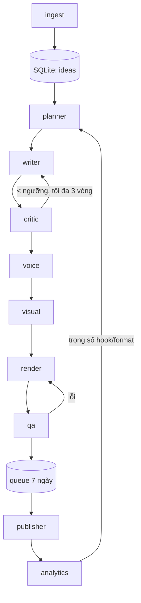

# Kế hoạch: Hệ thống AI Agents xuất bản video Endogenism lên Reels & TikTok

> Mục tiêu: biến 150 bài viết trong `endogenism/` thành **5 video ngắn/ngày** trên Instagram Reels và TikTok.
> Hệ thống chạy hoàn toàn tự động, chất lượng nội dung cao, đúng triết lý Nội Sinh, chi phí khoảng **50 USD/tháng**.

---

## 1. Các phương án đã chốt

| Hạng mục | Phương án chốt | Lý do |
|---|---|---|
| **Phong cách hình ảnh** | **Chữ động tối giản** (nền chính, khoảng 80%) + **stock footage chậm** (khoảng 20%) | Gần như miễn phí, ổn định, không bị "giả". Hình tĩnh lặng hợp với nội dung hướng vào bên trong. |
| **Giọng đọc** | **Clone giọng của bạn** qua ElevenLabs (gói Creator) | Giọng thật của người viết là yếu tố "nội sinh" mạnh nhất. API trả về timestamp từng ký tự nên không cần Whisper. |
| **LLM viết** | **Claude Sonnet** | Viết tiếng Việt tự nhiên và giữ giọng văn tốt nhất |
| **LLM chấm** | **GPT-4o-mini** (hoặc model mini tương đương) | Khác hãng với model viết, nên tránh tình trạng tự khen. Chi phí rất thấp. |
| **Điều phối** | **Python thuần + SQLite (state machine) + cron** | Đơn giản, dễ debug, không phụ thuộc framework |
| **Render video** | **Remotion** (React → MP4) | Template bằng code, phụ đề động đẹp. Miễn phí cho cá nhân hoặc team ≤ 3 người. |
| **Ứng dụng chạy** | **Desktop macOS App** (Electron + PixiJS + React) | Trực quan hóa văn phòng ảo, chạy trực tiếp trên máy |
| **Lưu trữ video** | **Cloudflare R2** | Miễn phí dưới 10GB, không tính phí băng thông tải xuống. Instagram API bắt buộc video có URL công khai. |
| **Stock footage** | **Pexels API** | Miễn phí, được dùng thương mại |
| **Nhạc nền** | **Thư viện tải sẵn 30 bài** từ Pixabay Music (ambient, piano, lo-fi chậm) | Miễn phí, được dùng thương mại, không rủi ro bản quyền |
| **Đăng bài** | **API chính chủ**: Instagram Graph API + TikTok Content Posting API | Miễn phí, chủ động |
| **Số clip mỗi bài** | **4 clip/bài → 600 video** | Đủ 120 ngày với 5 video/ngày, mỗi clip vẫn có một ý trọn vẹn |

---

## 2. Chi phí dự kiến hằng tháng

Giả định: khoảng 150 video/tháng, mỗi script khoảng 500 ký tự (≈ 35 giây đọc).

| Khoản | Ước tính |
|---|---|
| ElevenLabs Creator (100k credits, cần khoảng 75k ký tự/tháng + vài lần làm lại) | ~22 USD |
| Claude Sonnet (viết 3 phiên bản + tối đa 3 vòng sửa, có bật prompt caching) | ~15–20 USD |
| GPT-4o-mini (chấm điểm, QA nhìn khung hình) | ~2–3 USD |
| Cloudflare R2, Pexels, Pixabay Music, Remotion, API đăng bài | 0 USD |
| **Tổng** | **~40–45 USD/tháng** |

Chi phí một lần: Ingest 150 bài bằng Claude, khoảng 5–10 USD.

> Giá các dịch vụ có thể thay đổi. Cần kiểm tra lại khi đăng ký.

---

## 3. Luật nội dung theo triết lý Endogenism

### 3.1. Luật cứng (vi phạm thì loại script)
1. **Không gắn giá trị con người vào thành tích**, kể cả gián tiếp ("hãy cố lên để xứng đáng…").
2. **Không so sánh** với người khác, không dùng FOMO ("người khác đã…, còn bạn…").
3. **Không dùng hook gây sợ hoặc làm người xem xấu hổ** ("Bạn đang phá hủy đời mình").
4. **Không hứa hẹn kết quả** ("7 ngày để hết burnout").
5. **Không đưa lời khuyên y khoa hay tâm lý trị liệu.**
6. **Không kết video bằng mệnh lệnh.** Kết bằng câu hỏi, lời mời phản tư hoặc một sự công nhận.

### 3.2. Đặc điểm giọng văn (lấy từ bài gốc)
- Ngôi "bạn". Người kể đứng ngang hàng với người nghe, không đứng trên giảng giải.
- Câu ngắn, có nhịp, cho phép khoảng lặng.
- Gọi tên cảm giác cụ thể trước, giải thích sau.
- Dùng ẩn dụ đời thường ("cỗ máy chạy ngầm", "không có địa chỉ").
- Ưu tiên lấy nguyên văn các câu đắt từ bài gốc.

### 3.3. Chỉ số thành công
Ưu tiên theo thứ tự: **lượt lưu → chia sẻ → bình luận có chiều sâu → tỷ lệ xem hết** → lượt xem → lượt thích.

---

## 4. Năm format và lịch đăng mỗi ngày

| Giờ | Format | Độ dài | Hình ảnh | Cấu trúc |
|---|---|---|---|---|
| 06:30 | **Câu hỏi mang theo** | 15–20s | Chữ động, nền sáng | Bối cảnh 1 câu → Câu hỏi → "Mang theo nó hôm nay." |
| 11:30 | **Gọi tên** | 30–45s | Chữ động | Hook nhận diện → Mô tả cảm giác → Gọi tên → Mở góc nhìn → Câu hỏi |
| 17:00 | **Ngộ nhận và sự thật** | 30–40s | Chữ động, chia đôi màn hình | "Người ta nói…" → "Nhưng…" → Lý do → Câu hỏi |
| 20:00 | **Thực hành 60 giây** | 40–60s | Stock footage chậm + chữ | Vì sao → 3 bước rất nhỏ → Lời mời thử |
| 22:00 | **Đọc chậm** | 20–30s | Stock footage (ánh sáng, cửa sổ, cây) | Trích nguyên văn một đoạn trong bài, giọng chậm, nhạc piano |

**Tăng dần số lượng để tránh bị đánh dấu spam:**
- Tuần 1–2: 3 video/ngày (11:30, 20:00, 22:00)
- Tuần 3: 4 video/ngày
- Từ tuần 4: 5 video/ngày

**Luật xếp lịch:**
- Cách chọn mạch: 60% từ mạch hiện tại (đi tuần tự 1→5), 40% từ các mạch đã đăng.
- Không đăng 2 clip cùng bài trong vòng 3 ngày.
- Mỗi format có số tập riêng ("Gọi tên #12") để người xem theo dõi thành series.
- Luôn chuẩn bị sẵn **7 ngày video (35 clip)** trong hàng đợi.

**Sau 120 ngày:** chọn 20% video có lượt lưu và chia sẻ cao nhất, viết hook mới hoặc đổi format rồi đăng lại. Đồng thời làm thêm video tổng hợp (ví dụ "3 câu hỏi của Mạch 2").

---

## 5. Kiến trúc pipeline



Mỗi video là một bản ghi, đi qua các trạng thái theo thứ tự:

1. `planned`: đã xếp lịch
2. `scripted`: đã viết script
3. `approved`: script đã qua chấm điểm
4. `voiced`: đã có giọng đọc
5. `rendered`: đã dựng xong video
6. `qa_passed`: đã qua kiểm tra chất lượng
7. `queued`: đang chờ trong hàng đợi
8. `published`: đã đăng
9. `measured`: đã thu số liệu

Nếu lỗi ở bất kỳ bước nào, video chuyển sang `failed` kèm lý do.

### Chi tiết từng agent

| Agent | Đầu vào | Đầu ra | Model/Công cụ |
|---|---|---|---|
| **ingest** | file `.md` + `_meta.json` | 4–6 "hạt" mỗi bài: `insight`, `quote`, `metaphor`, `practice`, `question`, `emotion`, `format_fit` | Claude Sonnet (chạy 1 lần) |
| **planner** | Idea bank, lịch, trọng số từ analytics | Lịch 7 ngày tới | Python thuần (luật + trọng số) |
| **writer** | Hạt nội dung + đoạn bài gốc + skill của format | 3 phiên bản hook + 1 script + caption + 3–5 hashtag + câu hỏi gợi bình luận + gợi ý hình ảnh | Claude Sonnet |
| **critic** | Script + bộ luật mục 3 | Điểm theo rubric + góp ý sửa | GPT-4o-mini |
| **voice** | Script | MP3 + timestamp từng ký tự | ElevenLabs (giọng clone) |
| **visual** | Gợi ý hình ảnh | Clip từ Pexels (chỉ cho format 4, 5) | Pexels API |
| **render** | Giọng + timestamp + clip + nhạc | MP4 1080×1920, 30fps, −14 LUFS | Remotion |
| **qa** | MP4 | Đạt/lỗi (chữ tràn, che vùng giao diện app, lệch phụ đề, sai độ dài) | ffprobe + GPT-4o-mini vision (soát 4 khung hình) |
| **publisher** | Video trong hàng đợi đến giờ đăng | Đăng lên IG + TikTok, gắn nhãn AI | Graph API, Content Posting API |
| **analytics** | ID các video đã đăng | Số liệu sau 24h và 72h, cập nhật trọng số | IG Insights API, TikTok Display API |

### Rubric chấm của critic (thang 0–10)

| Tiêu chí | Trọng số |
|---|---|
| Hook đủ mạnh trong 2 giây và giúp người xem nhận ra mình (không gây sợ) | 25% |
| **Đúng triết lý** (mục 3.1) | 25% |
| Một video chỉ một ý, mạch rõ | 15% |
| Giọng văn giống bài gốc | 15% |
| Câu kết mở ra phản tư hoặc gợi bình luận | 10% |
| Câu ngắn, dễ đọc thành tiếng, đúng độ dài format | 10% |

**Điều kiện đạt:** tổng điểm ≥ 8.0 **và** điểm triết lý ≥ 9. Nếu không đạt sau 3 vòng thì đánh dấu hạt là `skipped` và lấy hạt khác.

---

## 6. Skills viết nội dung

Mỗi skill là một file `SKILL.md`, chắt lọc từ các framework viết video ngắn phổ biến rồi điều chỉnh theo Endogenism:

| Skill | Nội dung |
|---|---|
| `hook-writing` | Pattern interrupt, open loop, "gọi tên cảm giác", hook bằng câu hỏi, hook bằng mâu thuẫn. Kèm danh sách hook **bị cấm** (sợ hãi, so sánh, hứa hẹn). |
| `short-form-retention` | Cấu trúc Hook → Retain → Reward, nhịp mỗi 3–5 giây có thông tin mới, callback câu đầu ở cuối video để tạo vòng lặp |
| `endogenism-voice` | Đặc điểm giọng văn (mục 3.2) + 10 đoạn mẫu trích từ bài gốc |
| `endogenism-guardrails` | Luật cứng (mục 3.1) + 5 trụ cột + 3 câu hỏi cốt lõi |
| `format-*` (5 file) | Cấu trúc, độ dài, ví dụ mẫu của từng format |

---

## 7. Cấu trúc repo

```
auto_publishing_agents/
├── endogenism/                 # 150 bài gốc (đã có)
├── skills/
│   ├── hook-writing/SKILL.md
│   ├── short-form-retention/SKILL.md
│   ├── endogenism-voice/SKILL.md
│   ├── endogenism-guardrails/SKILL.md
│   └── format-{cau-hoi,goi-ten,ngo-nhan,thuc-hanh,doc-cham}/SKILL.md
├── agents/
│   ├── ingest.py
│   ├── planner.py
│   ├── writer.py
│   ├── critic.py
│   ├── voice.py
│   ├── visual.py
│   ├── render.py
│   ├── qa.py
│   ├── publisher.py
│   └── analytics.py
├── remotion/                   # 5 template ứng với 5 format
├── assets/music/               # 30 bài nhạc royalty-free
├── config/
│   ├── schedule.yaml           # giờ đăng, tăng dần số lượng, tỉ lệ mạch
│   └── rubric.yaml             # trọng số, ngưỡng điểm
├── data/app.db                 # SQLite
├── run.py                      # entrypoint cho cron
└── .env                        # API keys (không commit)
```

**Lịch cron:**
- `02:00` mỗi ngày: chạy planner → writer → critic → voice → render → qa để bù hàng đợi đủ 35 video
- Mỗi 5 phút: publisher kiểm tra và đăng video đã đến giờ
- `03:00` mỗi ngày: analytics thu số liệu
- `08:00` thứ Hai: gửi báo cáo tuần qua email hoặc Telegram (chỉ để đọc, không cần duyệt)

---

## 8. Lộ trình triển khai

| Giai đoạn | Việc cần làm | Điều kiện hoàn thành |
|---|---|---|
| **0. Chuẩn bị** (bạn làm) | Tạo IG Business/Creator liên kết Facebook Page; đăng ký Meta App và TikTok Developer App, **nộp audit TikTok ngay**; thu âm khoảng 3 phút giọng đọc để clone trên ElevenLabs; tạo Cloudflare R2 | Có đủ API keys |
| **1. Nội dung** | `ingest`, viết skills, `writer`, `critic` | 50 script mẫu đạt điểm ≥ 8, bạn đọc qua một lần để hiệu chỉnh giọng |
| **2. Sản xuất** | `voice`, 5 template Remotion, `render`, `qa` | 35 video đầu tiên có trong hàng đợi |
| **3. Xuất bản** | `publisher` cho IG trước, TikTok sau khi audit được duyệt | Đăng tự động đúng lịch |
| **4. Tự học** | `analytics`, cập nhật trọng số, báo cáo tuần, nút dừng khẩn cấp | Hệ thống chạy không cần can thiệp |

> **Trong lúc chờ TikTok duyệt audit:** app chưa được duyệt chỉ đăng được ở chế độ riêng tư. Hệ thống sẽ tải video lên dạng nháp (inbox) và bạn chỉ cần bấm "Đăng" trong app. Đây là bước thủ công duy nhất và chỉ là tạm thời.

---

## 9. Rủi ro và cách xử lý

| Rủi ro | Cách xử lý |
|---|---|
| TikTok chậm duyệt audit | Nộp ngay ở giai đoạn 0; trong lúc chờ dùng chế độ đăng nháp |
| Tài khoản mới đăng nhiều bị coi là spam | Tăng dần 3 → 4 → 5 video/ngày; mỗi caption và hook đều khác nhau |
| Nội dung lặp hoặc nhàm | Luật cách 3 ngày giữa các clip cùng bài; 5 format xoay vòng; analytics giảm trọng số format yếu |
| Lệch triết lý khi tối ưu theo thuật toán | Điểm triết lý ≥ 9 là điều kiện bắt buộc; chỉ số chính là lượt lưu và chia sẻ, không phải lượt xem |
| Chủ đề sức khỏe tâm thần nhạy cảm | Luật cấm lời khuyên y khoa; video nặng cảm xúc có kèm câu gợi ý tìm người hỗ trợ |
| Yêu cầu gắn nhãn nội dung AI | Publisher luôn bật cờ AI-generated, vì giọng đọc là giọng clone |
| Lỗi pipeline | Hàng đợi 7 ngày; mỗi bước tự thử lại 3 lần; thông báo qua Telegram khi một video bị `failed` |
| Lộ API key | Lưu trong `.env` trên máy cá nhân, phân quyền 600, không commit |
