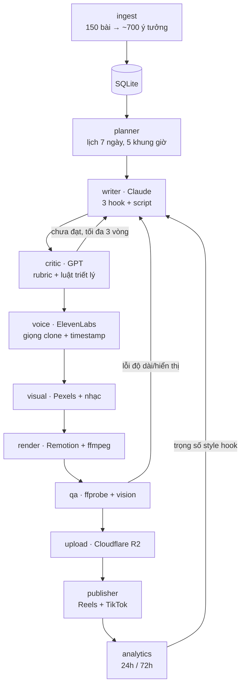

# Endogenism Auto-Publishing Agents

Hệ thống AI agents biến **150 bài viết Endogenism (Nội Sinh)** thành video ngắn và tự động đăng lên **Instagram Reels** và **TikTok**, mỗi ngày 5 video, không cần duyệt tay.

- Mọi ý tưởng lấy từ bài viết gốc. Câu trích dẫn được kiểm tra **nguyên văn** bằng code.
- Mỗi script được viết 3 hook, rồi được một model AI **khác hãng** chấm theo rubric và luật triết lý. Script chưa đạt sẽ bị trả lại để viết lại.
- Giọng đọc là **giọng clone của tác giả**, phụ đề chạy theo từng từ, font Việt được nhúng sẵn.
- Hệ thống tự học: style hook nào được **lưu và chia sẻ** nhiều thì được ưu tiên.

Kế hoạch chi tiết: [PLAN.md](PLAN.md).

---

## Kiến trúc



Mỗi video là một bản ghi đi qua các trạng thái:
`planned → scripted → approved → voiced → rendered → qa_passed → queued → published → measured` (hoặc `failed`).
Mọi hành động của agent được ghi vào bảng `events`, xem trực tiếp bằng `endo watch`.

## Cấu trúc thư mục

```
├── endogenism/          # 150 bài gốc (nguồn nội dung)
├── skills/              # SKILL.md: luật triết lý, giọng văn, hook, retention, 5 format
├── config/settings.yaml # lịch đăng, model, rubric, ngưỡng điểm, dry-run…
├── src/endo_agents/
│   ├── agents/          # ingest, planner, writer, critic, voice, visual, render, qa, upload, publisher, analytics
│   ├── integrations/    # ElevenLabs, Pexels, R2, Instagram, TikTok, Telegram
│   ├── captions.py      # timestamp ký tự → từ → khung phụ đề
│   ├── pipeline.py      # state machine + retry + khoá tiến trình
│   └── cli.py           # lệnh `endo`
├── remotion/            # 5 template video (React) + font nhúng
├── assets/music/        # nhạc nền royalty-free (calm/ reflective/ warm/)
├── deploy/              # script cài VPS + crontab
└── tests/
```

---

## Cài đặt (máy local hoặc VPS)

Yêu cầu: **Python ≥ 3.11**, **Node.js ≥ 18**, **ffmpeg**.

```bash
# 1. Python
python3.12 -m venv .venv
source .venv/bin/activate
pip install -e ".[dev]"

# 2. Remotion
cd remotion && npm install && cd ..

# 3. Bí mật
cp .env.example .env      # điền API keys (xem mục "Lấy API keys")

# 4. Nhạc nền (tuỳ chọn nhưng nên có)
#    Tải ~30 bài từ Pixabay Music vào assets/music/{calm,reflective,warm}/*.mp3

# 5. Kiểm tra
endo doctor
```

Mặc định `publish.dry_run: true`. Hệ thống làm mọi bước **trừ đăng thật**, nên an toàn khi demo.

---

## Demo nhanh (kịch bản trình diễn)

Mở 2 terminal:

```bash
# Terminal 1: dòng sự kiện trực tiếp của mọi agent
endo watch
```

```bash
# Terminal 2
endo ingest --limit 2            # tách 2 bài đầu thành ý tưởng
endo plan                        # lên lịch 7 ngày
endo status                      # xem hàng đợi
endo produce --limit 1           # 1 video: viết → chấm → giọng → dựng → QA
endo show 1                      # script, 3 hook, điểm critic, dòng thời gian
open data/media/00001/video.mp4  # xem video thành phẩm
endo publish                     # dry-run: in ra caption sẽ đăng
```

Xem và chỉnh template mà không cần API key:

```bash
cd remotion && npm run studio
```

---

## Các lệnh

| Lệnh | Việc làm |
|---|---|
| `endo doctor` | Kiểm tra keys, ffmpeg, Node, nhạc, kho ý tưởng, OAuth TikTok |
| `endo ingest [--limit N] [--article bai-001] [--force]` | Tách bài thành ý tưởng (chỉ xử lý lại bài đã thay đổi) |
| `endo plan` | Lấp các khung giờ trong 7 ngày tới (có tăng dần 3 → 4 → 5 video/ngày) |
| `endo produce [--limit N] [-v ID]` | Chạy pipeline sản xuất cho video đã lên lịch |
| `endo daily` | `plan` + `produce` (chạy bằng cron) |
| `endo publish` | Đăng các video đã đến giờ (cron mỗi 5 phút) |
| `endo analytics` | Thu số liệu 24h/72h, cập nhật trọng số học |
| `endo report` | Báo cáo tuần (in ra + gửi Telegram) |
| `endo status` | Tổng quan trạng thái + hàng đợi sắp tới |
| `endo show ID` | Toàn bộ thông tin một video |
| `endo watch` | Dòng sự kiện realtime |
| `endo pause` / `endo resume` | Dừng khẩn cấp / tiếp tục đăng |
| `endo tiktok-auth` | Kết nối tài khoản TikTok (một lần) |

---

## Lấy API keys

| Biến | Lấy ở đâu |
|---|---|
| `ANTHROPIC_API_KEY` | console.anthropic.com → API Keys |
| `OPENAI_API_KEY` | platform.openai.com → API keys |
| `ELEVENLABS_API_KEY`, `ELEVENLABS_VOICE_ID` | elevenlabs.io (gói Creator) → Voices → **Instant/Professional Voice Clone** bằng ~3 phút giọng thu âm → copy Voice ID |
| `PEXELS_API_KEY` | pexels.com/api |
| `R2_*` | Cloudflare → R2 → tạo bucket (để **private**) → Manage API Tokens (quyền Object Read & Write) |
| `IG_USER_ID`, `IG_ACCESS_TOKEN` | Meta for Developers → App → Instagram Graph API. Nên dùng **System User token** (Business Manager) để token không hết hạn. Quyền: `instagram_basic`, `instagram_content_publish`, `instagram_manage_insights`, `pages_read_engagement` |
| `TIKTOK_CLIENT_KEY`, `TIKTOK_CLIENT_SECRET`, `TIKTOK_REDIRECT_URI` | developers.tiktok.com → App → bật **Content Posting API** + **Login Kit**, scopes `video.upload`, `video.publish`, `video.list`. Redirect URI là một URL https bạn sở hữu |
| `TELEGRAM_*` (tuỳ chọn) | Tạo bot với @BotFather, lấy chat id |

### TikTok: audit và chế độ đăng
1. Chạy `endo tiktok-auth`, mở link, bấm cho phép, rồi dán URL được chuyển tới vào terminal.
2. Khi app **chưa qua audit**, giữ `publish.tiktok_mode: inbox`. Video sẽ vào hộp nháp TikTok và bạn nhận thông báo Telegram để bấm "Đăng".
3. Khi audit được duyệt, đổi sang `tiktok_mode: direct`. Video sẽ đăng công khai hoàn toàn tự động và được gắn nhãn AI (`is_aigc`).

### Bật đăng thật
Trong `config/settings.yaml`, đổi `publish.dry_run: false`. Có thể bật từng nền tảng qua `publish.platforms`.

---

## Triển khai lên VPS (Ubuntu 22.04/24.04)

```bash
git clone <repo> ~/endo && cd ~/endo
bash deploy/setup_vps.sh         # cài Python, Node, ffmpeg, Chrome deps, venv, npm, đặt múi giờ VN
nano .env                        # điền keys (chmod 600 tự động)
.venv/bin/endo doctor
.venv/bin/endo ingest            # chạy một lần cho 150 bài
.venv/bin/endo tiktok-auth
crontab deploy/crontab.local     # bật lịch tự động (file do setup_vps.sh sinh ra)
```

Lịch cron ([deploy/crontab](deploy/crontab)), theo giờ Việt Nam:

| Giờ | Lệnh |
|---|---|
| 02:00 hằng ngày | `endo daily`: lên lịch và sản xuất cho đủ 7 ngày |
| mỗi 5 phút | `endo publish` |
| 03:00 hằng ngày | `endo analytics` |
| 08:00 thứ Hai | `endo report` |

---

## Cấu hình chính (`config/settings.yaml`)

- `schedule.slots`: 5 khung giờ và format tương ứng. `ramp_up`: tăng dần số video mỗi ngày cho tài khoản mới.
- `models`: model cho từng agent.
- `critic`: trọng số rubric và ngưỡng đạt (tổng ≥ 8, triết lý ≥ 9, không vi phạm luật cứng).
- `formats`: độ dài mục tiêu, kiểu hình ảnh, tâm trạng nhạc.
- `analytics.score_weights`: điểm "chiều sâu" (lưu ×4, chia sẻ ×3, bình luận ×2, thích ×0.5) trên 1.000 lượt xem.

Nội dung và giọng văn được điều khiển bởi các file trong [skills/](skills). Sửa skill là đổi cách agent viết, không cần sửa code.

---

## An toàn và vận hành

- **Bí mật** chỉ nằm trong `.env` (không commit). File DB lưu token OAuth với quyền `600`. Bucket R2 để private, Instagram nhận video qua link ký tạm thời 6 giờ.
- **Dừng khẩn cấp**: `endo pause`.
- **Chống chạy chồng**: mỗi lệnh cron có file lock riêng.
- **Thử lại**: mỗi bước thử tối đa 3 lần. Lỗi kỹ thuật thì trả ý tưởng về kho; script bị critic loại thì đánh dấu ý tưởng `skipped`.
- **Cảnh báo**: Telegram nhận thông báo khi video thất bại hoặc đăng lỗi.
- **Log**: `data/logs/endo.log` và bảng `events`.

## Xử lý sự cố

| Triệu chứng | Cách xử lý |
|---|---|
| Remotion không tải được Chrome Headless Shell (proxy công ty) | Đặt `REMOTION_BROWSER_EXECUTABLE` tới Chrome có sẵn, ví dụ `/Applications/Google Chrome.app/Contents/MacOS/Google Chrome` |
| `Missing secret …` | Điền biến đó trong `.env`, chạy `endo doctor` |
| Video bị QA trả về liên tục vì độ dài | Giảm `voice.speed` hoặc nới `render.duration_slack` |
| TikTok báo `unaudited_client_can_only_post_to_private_accounts` | Giữ `tiktok_mode: inbox` cho tới khi audit xong |

## Kiểm thử

```bash
pytest
cd remotion && npm run typecheck
```
