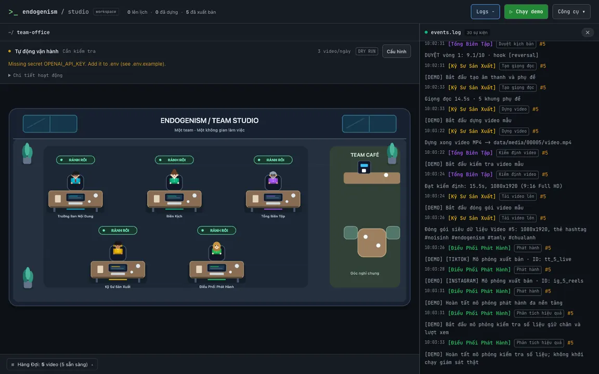
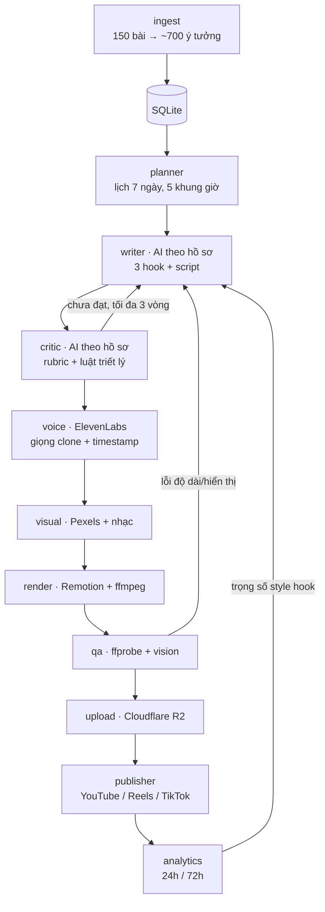

# Endogenism Auto-Publishing Agents

Hệ thống AI agents biến **150 bài viết Endogenism (Nội Sinh)** thành video ngắn và phát hành theo lịch lên các nền tảng được cấu hình (YouTube, Instagram Reels, TikTok). Chế độ **Tự động vận hành** tự bổ sung công việc trong giới hạn ngày, không dùng lại ý tưởng đã có video.

- Mọi ý tưởng lấy từ bài viết gốc. Câu trích dẫn được kiểm tra **nguyên văn** bằng code.
- Mỗi script được viết 3 hook, rồi được Tổng Biên Tập chấm theo rubric và luật triết lý. Có thể chọn **Gemini, GPT hoặc Claude riêng cho từng agent**, không bắt buộc khác hãng.
- Giọng đọc là **giọng clone của tác giả**, phụ đề chạy theo từng từ, font Việt được nhúng sẵn.
- Hệ thống tự học: style hook nào được **lưu và chia sẻ** nhiều thì được ưu tiên.

Kế hoạch chi tiết: [PLAN.md](PLAN.md).

## Xem nhanh

*Bản ghi demo offline từ giao diện thật; đoạn chờ dựng video đã được rút ngắn. Demo không gọi AI hoặc đăng bài thật. Cảnh báo thiếu API key thuộc chế độ tự động, không ngăn chạy demo.*



## Bắt đầu ở đâu?

- [Cài đặt và mở dashboard](#cài-đặt-máy-cá-nhân)
- [Chạy demo không cần API key](#demo-nhanh-kịch-bản-trình-diễn)
- [Cấu hình hồ sơ agent](#hồ-sơ-agent--kỹ-năng)
- [Chọn Gemini / GPT / Claude và tải danh sách model](#chọn-nhà-cung-cấp-và-model)
- [Bật tự tạo việc liên tục](#tự-tạo-việc-mới-liên-tục)
- [Triển khai production / VPS](#chạy-production--vps)
- [Xử lý sự cố](#xử-lý-sự-cố)

---

## Kiến trúc



Mỗi video là một bản ghi đi qua các trạng thái:
`planned → scripted → approved → voiced → rendered → qa_passed → queued → published → measured` (hoặc `failed`).
Mọi hành động của agent được ghi vào bảng `events`, xem trực tiếp bằng `endo watch`.

## Cấu trúc thư mục

```
├── endogenism/          # 150 bài gốc (nguồn nội dung)
├── skills/              # SKILL.md: luật triết lý, giọng văn, hook, retention, 5 format
├── config/settings.yaml # lịch đăng thủ công, rubric, render, dry-run…
├── packages/core/       # AI agents, integrations, SQLite, pipeline, captions
├── apps/
│   ├── cli/             # CLI `endo` và demo offline
│   ├── web/             # Web workspace @endo/web
│   │   ├── src/         # Frontend React + PixiJS, HTTP/SSE client
│   │   ├── server/      # Express API, SSE, scheduler, quản lý tác vụ
│   │   ├── shared/      # Hợp đồng API, kiểu dữ liệu, ánh xạ hoạt động
│   │   └── dist/        # Frontend build (tự sinh, không commit)
│   └── remotion/        # 5 template video (React) + font nhúng
├── assets/music/        # nhạc nền royalty-free (calm/ reflective/ warm/)
└── data/                # SQLite, log, media (không commit)
```

---

## Cài đặt (Máy cá nhân)

Yêu cầu: **Node.js ≥ 20**, **npm**.

```bash
# 1. Cài tất cả dependencies của monorepo (chỉ cần lần đầu / khi cập nhật)
npm install --include=dev

# 2. Chạy web app: tự build core/CLI, khởi động backend và frontend cùng một cổng
npm run dev
```

Mở URL được in trong terminal (mặc định `http://127.0.0.1:5173`). Nếu cổng mặc định bận, server tự thử 10 cổng kế tiếp, không dừng tiến trình khác. Khi đặt `PORT` cụ thể, server báo lỗi nếu cổng đó bận. Nhấn **Ctrl+C** để dừng server và các tác vụ do web quản lý.

Mỗi thư mục dữ liệu chỉ chạy một web server; chạy lệnh khởi động lần nữa sẽ báo PID của server hiện có thay vì tạo lịch xuất bản trùng.

Không cần Electron, tải binary Electron, đóng gói `.app` hay DMG. `npm run` không có tên chỉ liệt kê scripts; dùng `npm run dev` để khởi động.

Có thể nhập API keys trong **Cấu hình** trên web; không cần API key chỉ để mở dashboard. Sản xuất thật cần API keys, FFmpeg/ffprobe và Chromium cho Remotion. Kiểm tra bằng **Doctor** hoặc `npm run endo -- doctor`. Kiểm tra `publish.dry_run` trong `config/settings.yaml` trước khi chạy xuất bản thật.

---

## Demo nhanh (kịch bản trình diễn)

Mở 2 terminal:

```bash
# Terminal 1: dòng sự kiện trực tiếp của mọi agent
npm run endo watch
```

```bash
# Terminal 2: Chạy demo offline hoàn chỉnh không cần API key
npm run endo demo

# Các lệnh thật để vận hành từng bước (cần API keys):
npm run endo ingest -- --limit 2     # tách 2 bài đầu thành ý tưởng
npm run endo plan                    # lên lịch 7 ngày
npm run endo status                  # xem hàng đợi
npm run endo show 1                  # script, 3 hook, điểm critic, dòng thời gian
open data/media/00001/video.mp4      # macOS: thay ID bằng video vừa tạo
```

**Demo không gọi AI, giọng đọc hoặc API phát hành thật**, nhưng vẫn dựng video bằng Remotion/FFmpeg và ghi dữ liệu mẫu vào SQLite. Các ID có thể khác sau nhiều lần chạy. Demo không dùng để kiểm tra model, API keys hay chất lượng prompt.

Các lệnh `ingest`, `plan` và `produce` là **tác vụ thật**, không phải từng bước của demo: cần API keys phù hợp với hồ sơ agent; sản xuất còn cần dịch vụ giọng đọc và công cụ render. `dry_run` chỉ ngăn đăng thật, không ngăn chi phí sản xuất.

Xem và chỉnh template mà không cần API key:

```bash
npm run remotion:studio
```

---

## Các lệnh

| Lệnh | Việc làm |
|---|---|
| `endo doctor` | Kiểm tra keys, ffmpeg, Node, nhạc, kho ý tưởng, OAuth TikTok |
| `endo ingest [--limit N] [--article bai-001] [--force]` | Tách bài thành ý tưởng (chỉ xử lý lại bài đã thay đổi) |
| `endo plan` | Lấp các khung giờ trong 7 ngày tới (có tăng dần 3 → 4 → 5 video/ngày) |
| `endo produce [--limit N] [-v ID]` | Chạy pipeline sản xuất cho video đã lên lịch |
| `endo daily` | `plan` + `produce` (chạy bằng cron) |
| `endo auto-cycle` | Một chu kỳ nạp bài mới + bổ sung lịch theo khoảng chuẩn bị + sản xuất + phát hành; chỉ chạy khi đã bật tự động, do web scheduler quản lý |
| `endo publish` | Đăng các video đã đến giờ (cron mỗi 5 phút) |
| `endo analytics` | Thu số liệu 24h/72h, cập nhật trọng số học |
| `endo report` | Báo cáo tuần (in ra + gửi Telegram) |
| `endo status` | Tổng quan trạng thái + hàng đợi sắp tới |
| `endo show ID` | Toàn bộ thông tin một video |
| `endo watch` | Dòng sự kiện realtime |
| `endo pause` / `endo resume` | Dừng khẩn cấp / tiếp tục đăng |
| `endo tiktok-auth` | Kết nối tài khoản TikTok (một lần) |

---

## Lấy API keys

| Biến | Lấy ở đâu |
|---|---|
| `GEMINI_API_KEY` | [Google AI Studio](https://aistudio.google.com/apikey) → tạo API key cho Gemini |
| `ANTHROPIC_API_KEY` | console.anthropic.com → API Keys |
| `OPENAI_API_KEY` | platform.openai.com → API keys |
| `ELEVENLABS_API_KEY`, `ELEVENLABS_VOICE_ID` | elevenlabs.io (gói Creator) → Voices → **Instant/Professional Voice Clone** bằng ~3 phút giọng thu âm → copy Voice ID |
| `PEXELS_API_KEY` | pexels.com/api |
| `PIXABAY_API_KEY` | [Pixabay API](https://pixabay.com/api/docs/) → API key; có thể dùng thay Pexels |
| `YOUTUBE_CLIENT_ID`, `YOUTUBE_CLIENT_SECRET`, `YOUTUBE_REFRESH_TOKEN` | Google Cloud Console → bật YouTube Data API v3, tạo OAuth client và cấp quyền tài khoản kênh |
| `R2_*` | Cloudflare → R2 → tạo bucket (để **private**) → Manage API Tokens (quyền Object Read & Write) |
| `IG_USER_ID`, `IG_ACCESS_TOKEN` | Meta for Developers → App → Instagram Graph API. Nên dùng **System User token** (Business Manager) để token không hết hạn. Quyền: `instagram_basic`, `instagram_content_publish`, `instagram_manage_insights`, `pages_read_engagement` |
| `TIKTOK_CLIENT_KEY`, `TIKTOK_CLIENT_SECRET`, `TIKTOK_REDIRECT_URI` | developers.tiktok.com → App → bật **Content Posting API** + **Login Kit**, scopes `video.upload`, `video.publish`, `video.list`. Redirect URI là một URL https bạn sở hữu |
| `TELEGRAM_*` (tuỳ chọn) | Tạo bot với @BotFather, lấy chat id |

Chỉ cần key của nhà cung cấp AI mà các agent đang chọn; không cần nhập cả ba. Nhập tại **Công cụ → Kết nối & API keys** hoặc `.env`, sau đó chọn model cho từng agent trong **Agent & kỹ năng**. Có Gemini key không tự thay thế GPT/Claude. Không commit `.env` hoặc chia sẻ API keys.

### TikTok: audit và chế độ đăng
1. Chạy `endo tiktok-auth`, mở link, bấm cho phép, rồi dán URL được chuyển tới vào terminal.
2. Khi app **chưa qua audit**, giữ `publish.tiktok_mode: inbox`. Video sẽ vào hộp nháp TikTok và bạn nhận thông báo Telegram để bấm "Đăng".
3. Khi audit được duyệt, đổi sang `tiktok_mode: direct`. Video sẽ đăng công khai hoàn toàn tự động và được gắn nhãn AI (`is_aigc`).

### Bật đăng thật
Trong `config/settings.yaml`, đổi `publish.dry_run: false`. Có thể bật từng nền tảng qua `publish.platforms`.

---

## Web app (Endogenism Studio)

Ứng dụng trực quan hóa toàn bộ quy trình sản xuất video bằng văn phòng ảo 2D: mỗi agent là một nhân vật hoạt hình tương tác, trao đổi và làm việc trong thời gian thực.

Tính năng trên web:
- **Canvas PixiJS tương tác**: 5 nhân vật cùng một team ngồi trong một phòng chung, bố trí 3 bàn trên / 2 bàn dưới, không chia phòng. Trên đầu chỉ có indicator: vàng **ĐANG LÀM**, xanh **RẢNH RỖI**, đỏ **GẶP LỖI**, không có nhãn tên/chức vụ. Chỉ nhân vật đang làm mới gõ phím; lời thoại chi tiết xuất hiện khi trỏ/chọn, không mở bảng điều khiển nổi hoặc các nút cà phê/giao lưu.
- **Góc Team Café**: Khu nghỉ rộng bên phải với quầy pha cà phê, bàn và hai ghế. Mỗi 20–35 giây, chọn ngẫu nhiên một nhân vật đang rảnh để ghé nghỉ; tối đa hai người cùng lúc. Nghỉ 18–30 giây sau khi tới ghế rồi tự quay về bàn, chờ ít nhất 45 giây trước lần nghỉ tiếp. Nhân vật được giao việc trở về bàn ngay, không chờ kết thúc hoạt cảnh. Agent khác đang làm việc không ngăn người rảnh nghỉ; cà phê chỉ là trang trí, không thay đổi trạng thái backend.
- **Workspace responsive**: Giao diện tối kiểu developer, thanh công cụ gọn và nhật ký `events.log` dùng font monospace, không còn dải trạng thái 5 agent. Desktop đặt văn phòng và logs cạnh nhau; tablet/điện thoại xếp logs bên dưới, vuốt ngang riêng trong văn phòng để giữ nhân vật dễ nhìn. Có thể đóng/mở Logs, xem hàng đợi và truy cập hồ sơ agent qua Công cụ. Nút **Chạy demo** chạy mô phỏng offline; tác vụ sản xuất/phát hành thật và Dừng/Reset nằm trong Công cụ.
- **Hàng đợi xuất bản (Kanban)**: Xem 7 ngày lịch đăng, xem trước 3 hook, phân đoạn kịch bản và điểm rubric.
- **Phát video MP4 trực tiếp**: Bấm vào video bất kỳ để xem thành phẩm.
- **Quản lý cấu hình**: Chỉnh sửa API keys và kiểm tra kết nối (Doctor) ngay trên giao diện.
- **Realtime**: Log và sự kiện truyền qua SSE, tự kết nối lại; lịch sử gần nhất được nạp lại khi reconnect.
- **Chức danh thống nhất**: Tên bàn, hồ sơ thành viên và nhãn người thực hiện trong Logs cùng dùng Trưởng Ban Nội Dung, Biên Kịch, Tổng Biên Tập, Kỹ Sư Sản Xuất, Điều Phối Phát Hành. Logs có nhãn công đoạn tiếng Việt để phân biệt các việc do cùng một người phụ trách (nạp ý tưởng/lên lịch, duyệt kịch bản/kiểm định video…). Mã kỹ thuật vẫn giữ trong dữ liệu và tooltip để tra cứu; sự kiện tự động/hệ thống không gán nhầm cho thành viên.
- **Trạng thái nhân vật**: Backend gửi trạng thái công đoạn thực tế (bắt đầu/kết thúc/lỗi) cùng job hiện tại. Lịch sử audit không kích hoạt lại animation; reload/reconnect lấy snapshot hiện tại. `ingest/planner` thuộc Trưởng Ban, `critic/qa` thuộc Tổng Biên Tập, `voice/visual/render/upload` thuộc Kỹ Sư Sản Xuất. Không tự diễn cảnh bàn giao hoặc nói đã duyệt/xuất bản khi chưa có kết quả. Hoạt cảnh cà phê chỉ dành cho người rảnh, được hủy riêng cho nhân vật nhận tác vụ, không kéo người rảnh khác về bàn.
- **Nhịp demo**: Mỗi bước mô phỏng giữ trạng thái làm việc ít nhất 2,2 giây giữa sự kiện `started` và `finished`, để luồng cập nhật 0,5 giây hiển thị đủ các nhân vật theo lượt. Render có thể lâu hơn do dựng video thật; những người không phụ trách công đoạn hiện tại vẫn rảnh. Phát hành và analytics trong demo chỉ là mô phỏng, không khởi chạy giám sát thật.
- **Lịch hoạt động agent**: Thanh vận hành gọn trên văn phòng hiển thị chế độ, trạng thái, giới hạn ngày, dry run/đăng thật và đếm ngược kiểm tra theo đồng hồ server. **Chi tiết hoạt động** mở lý do đang chờ, lịch video và giờ kiểm tra theo múi giờ thiết bị; mặc định thu gọn để dành diện tích cho văn phòng. Lỗi và mất kết nối luôn hiện bên ngoài phần thu gọn, không tiếp tục hứa lịch chạy. **Cấu hình** mở hộp thoại thống nhất với thanh trạng thái: khoảng chuẩn bị, chu kỳ kiểm tra, giới hạn ngày, nền tảng, chế độ đăng, cảnh báo chi phí và xác nhận; giải thích dài nằm trong **Giới hạn & cơ chế an toàn**. Scheduler dùng chu kỳ đã lưu khi bật Tự động vận hành, bỏ qua khi tác vụ khác còn chạy. Khi chưa bật chế độ này, chỉ kiểm tra phát hành video `qa_passed`/`queued` đến giờ mỗi 60 giây; không tự Plan/Produce.
- **Tác vụ nền**: Mỗi lệnh chạy thành một job trên server, không phụ thuộc việc tab còn mở. Một job tại một thời điểm; trạng thái và phần cuối log được lưu trong SQLite. Server restart đánh dấu job đang chạy là `interrupted`, không tự chạy lại tác vụ có thể đã xuất bản.
- **Lịch xuất bản**: Kiểm tra video đến hạn mỗi 60 giây khi server còn chạy. Nút dừng/reset tạm dừng lịch; chạy một tác vụ thủ công hoặc `npm run endo -- resume` để tiếp tục. Bản đầu dùng một server instance và một SQLite trên ổ đĩa cục bộ; không chạy thêm worker/CLI sửa dữ liệu đồng thời với reset.

Để chỉ xem dashboard mà không tự động xuất bản theo lịch, khởi động với `STUDIO_SCHEDULER=off npm run dev` (hoặc `npm start`). Các thao tác xuất bản thủ công vẫn hoạt động.

Menu **Công cụ** dành cho quản trị viên: **Vận hành** (Lên lịch, Sản xuất 1 video, Phát hành đến lịch, Dừng tác vụ), **Cấu hình** (Agent & kỹ năng, Kết nối & API keys), **Hệ thống** (Chẩn đoán, Reset có xác nhận). Lệnh tạo tác vụ và demo bị khóa khi đang có tác vụ; dừng không xóa dữ liệu. Không có thao tác cà phê hay Remotion trong menu này. Remotion Studio là công cụ chỉnh template riêng cho developer: chạy `npm run remotion:studio` và mở URL được in ra, không tự mở dịch vụ không được bảo vệ trên VPS.

### Tổ chức mã nguồn web

- `apps/web/src/`: giao diện, trạng thái trình duyệt và canvas. Các màn hình gọi HTTP/SSE qua module `src/core/api.ts`, không dùng preload/IPC hay API gắn vào `window`.
- `apps/web/server/`: backend Node.js; quản lý dữ liệu, cấu hình, job CLI và scheduler. Không import kiểu dữ liệu từ frontend.
- `apps/web/shared/`: hợp đồng dùng chung giữa frontend/backend; profile và metadata kỹ năng dùng lại kiểu từ `packages/core`.
- `packages/core/`: nghiệp vụ và tích hợp dịch vụ; `apps/cli/` là worker CLI mà backend khởi chạy; `apps/remotion/` chứa template/render.

Chạy npm từ **gốc repository** và dùng `package-lock.json` ở gốc cho các workspace. Workspace web là `@endo/web`, thư mục là `apps/web`; không còn `apps/desktop` hay Electron. Khi cập nhật từ cấu trúc cũ, dừng server cũ, chạy `npm install --include=dev`, `npm run build`, rồi `npm start`. Không di chuyển/xóa `data/`, `.env` hoặc cấu hình; việc đổi workspace không reset dữ liệu. Không dùng tsconfig ở gốc: mỗi workspace có cấu hình TypeScript riêng; web kiểm tra frontend và backend bằng hai tsconfig.

### Tự tạo việc mới liên tục

Mở **Cấu hình** ở thanh vận hành hoặc **Công cụ → Vận hành → Tự động vận hành**. Có thể chỉnh:

| Cấu hình | Giá trị | Áp dụng thực tế |
|---|---|---|
| Chuẩn bị trước | **1–168 giờ**, mặc định **24** | Bổ sung lịch mới và chọn video sản xuất trong khoảng từ hiện tại tới giới hạn này; video quá hạn vẫn được xử lý |
| Chu kỳ kiểm tra | **30–3600 giây**, mặc định **60** | Đặt lại lần kiểm tra kế tiếp ngay khi lưu; không chạy chồng nếu job trước còn hoạt động |
| Nền tảng | Ít nhất một trong **YouTube / Instagram / TikTok** | Dùng cho upload/sản xuất và phát hành tự động, kể cả video đang chờ; không đăng lại video đã hoàn tất |
| Giới hạn mỗi ngày | **1–20**, mặc định **3** | Giới hạn số lịch, lượt bắt đầu sản xuất và số bài nạp theo ngày |

**Lưu cấu hình** không bật chế độ hoặc bỏ chặn lỗi. Có thể lưu ngay cả khi đang tắt; khi đang có tác vụ, chờ tác vụ kết thúc trước khi lưu. **Bật tự động vận hành** cần xác nhận chi phí và bắt đầu một chu kỳ ngay; **Tạm dừng tự động** dùng cấu hình đã lưu, không vô tình áp dụng bản nháp đang nhập. Cấu hình lưu trong SQLite và tiếp tục có hiệu lực sau restart. Lần đầu nâng cấp dùng mặc định 24 giờ/60 giây và lấy nền tảng cũ từ YAML; không thay đổi dữ liệu hay reset.

Danh sách nền tảng này **chỉ áp dụng Tự động vận hành**; lệnh phát hành/sản xuất thủ công và scheduler phát hành cũ vẫn theo `publish.platforms` trong YAML. Bỏ chọn một nền tảng không xóa bản ghi phát hành của nó; kết quả không rõ (`publishing`/`review_required`) vẫn phải được đối soát, không thể né bằng cách bỏ chọn nền tảng. Chọn nền tảng không tự cung cấp API keys hay đổi `publish.dry_run`. Giữ nguyên dry run/đăng thật khi lưu.

Chế độ mặc định **tắt**; cập nhật code không tự bật. Khi đã bật:

1. Mỗi chu kỳ phát hành các video tới hạn trước, bổ sung lịch trong **khoảng chuẩn bị đã chọn** bằng ý tưởng chưa dùng. Giảm khoảng chuẩn bị không xóa/dời lịch cũ; video ngoài khoảng chỉ chờ tới khi đủ gần để sản xuất.
2. Nếu không có video cần sản xuất, đọc tối đa một bài nguồn chưa nạp/đã đổi nội dung, tách ý tưởng rồi bổ sung lịch. Bài không đổi không bị gọi API nạp lại; hết ý tưởng phù hợp thì chờ bài/khung giờ mới, không tự bịa nguồn hoặc remake để lấp lịch.
3. Sản xuất tối đa một video mỗi chu kỳ. Giới hạn số lịch theo ngày phát hành và lượt bắt đầu sản xuất theo ngày thực hiện, đều tính theo `timezone` trong cấu hình; lượt sản xuất lỗi cũng tính. Số bài nguồn gọi API nạp mỗi ngày cũng không vượt giới hạn này. Hàng đợi cũ không bị xóa khi hạ giới hạn; các video đã sẵn sàng vẫn được phát hành đúng lịch.
4. Cấu hình, ngân sách ngày và lịch sử lưu trong SQLite, không phụ thuộc tab trình duyệt. Server restart giữa hai chu kỳ tự tiếp tục; nếu bị ngắt ngay trong chu kỳ, chặn tự động để quản trị kiểm tra. VPS cần dịch vụ luôn chạy (systemd/PM2); không thiết lập thêm cron `daily`/`publish` song song.

**Chống trùng:** không xóa ý tưởng cũ khi nạp lại bài; prompt có các góc đã tồn tại; lọc trùng/gần trùng góc nhìn hoặc insight sau chuẩn hóa Unicode/chữ hoa/dấu câu và độ giao nhau từ. Planner không dùng ý tưởng đã liên kết bất kỳ video nào, kể cả video lỗi; không còn tự remake. Trước sản xuất/phát hành tự động kiểm tra lại lịch sử; trước tạo giọng đọc và phát hành còn so sánh phần thân kịch bản, không chỉ dựa vào tiêu đề/hook. Một bài có thể tạo nhiều video nếu khác ý tưởng, vẫn tuân theo `same_article_gap_days` (mặc định 3 ngày) và lịch ramp-up. Lọc từ không đảm bảo phát hiện mọi bản viết lại cùng nghĩa nhưng dùng từ hoàn toàn khác; cần kiểm tra biên tập khi yêu cầu độc nhất ngữ nghĩa tuyệt đối.

**An toàn khi có lỗi:** lỗi nạp/sản xuất/phát hành chặn chu kỳ mới thay vì gọi API liên tục. UI hiển thị lý do; xử lý rồi bật lại có xác nhận. Đăng thật đặt trạng thái `publishing` trước khi gọi nền tảng; lỗi không rõ kết quả chuyển `review_required`, không tự upload lại. Quản trị phải đối soát nền tảng và cập nhật bản ghi publication đúng kết quả trước khi bật lại (chưa có màn hình đối soát riêng). Không xóa bản ghi để thử đăng lại khi chưa chắc bài chưa được đăng.

**Tạm dừng tự động / Dừng tác vụ** tắt chế độ liên tục, giữ dữ liệu/ngân sách và tạm dừng lịch phát hành; nếu chu kỳ đang chạy sẽ dừng tiến trình đó. Chạy tác vụ thủ công chỉ mở lại lịch phát hành cũ, **không** tự bật lại chế độ tạo việc. Reset xóa dữ liệu, lịch sử chống trùng và ngân sách; không dùng Reset cho nhu cầu tạm dừng.

Dry run chỉ ngăn đăng thật, **không ngăn chi phí LLM/voice/render/storage**. Cấu hình nền tảng thủ công, TikTok inbox/direct và `publish.dry_run` trong [config/settings.yaml](config/settings.yaml); restart server sau khi đổi YAML để UI báo đúng chế độ. Các trường Tự động vận hành trên UI áp dụng sau khi lưu, không cần restart. TikTok inbox vẫn cần bấm đăng trong ứng dụng TikTok; analytics không nằm trong chu kỳ tự động mới này. Backend cập nhật tính năng cần restart một lần; sau đó bấm Bật trong UI, không phải Chạy demo.

### Hồ sơ agent & kỹ năng

Mở **Công cụ → Agent & kỹ năng**. Chọn một trong 5 chức danh để chỉnh **vai trò & trách nhiệm, kỹ năng, chỉ dẫn bổ sung, phong cách, nhà cung cấp, model ID và temperature**. Hồ sơ được dùng ở các bước sau; temperature chỉ gửi khi model hỗ trợ:

| Chức danh | Nơi hồ sơ được áp dụng |
|---|---|
| Trưởng Ban Nội Dung | Tách ý tưởng từ nguồn và xếp ưu tiên tối đa 100 ý tưởng chưa dùng cho planner |
| Biên Kịch | Viết kịch bản và ba hook theo format |
| Tổng Biên Tập | Duyệt kịch bản và QA hình ảnh video |
| Kỹ Sư Sản Xuất | Chọn từ khóa cảnh quay và loại nhạc hợp lệ trước chuẩn bị tư liệu/dựng |
| Điều Phối Phát Hành | Rà soát metadata trước khi tạo publication; từ chối có lý do khi không đạt |

Kỹ năng được nạp từ file thật; thiếu kỹ năng báo lỗi thay vì âm thầm bỏ qua. Guardrails bắt buộc và ràng buộc công đoạn luôn được thêm, không thể tắt bằng cách bỏ chọn kỹ năng hoặc viết chỉ dẫn trái ngược. Kết quả AI phải đúng schema: planner chỉ ưu tiên ID được cung cấp; kỹ sư chỉ chọn nhạc trong danh sách; phát hành chỉ tiếp tục khi được duyệt. Giọng đọc vẫn dùng nguyên kịch bản đã duyệt; kỹ năng/chỉ dẫn không tự thay voice ID, template, thông số render, lịch, hạn mức, QA, nền tảng hay dry run. Các thiết lập kỹ thuật này vẫn theo cấu hình hệ thống. Thu thập analytics vẫn là thao tác API/tính điểm cố định, không dùng prompt để sửa số liệu.

Planner dùng cùng hồ sơ ở lệnh Plan, Daily và Tự động vận hành; pipeline thủ công và tự động đều dùng hồ sơ sản xuất/phát hành. Demo offline không gọi AI và không kiểm chứng prompt. Các bước quyết định mới làm tăng chi phí API; ưu tiên planner được cache khi danh sách/profile/ngày/cấu hình không đổi. Kết quả duyệt phát hành được giữ cho cùng kịch bản/profile/nền tảng/chế độ, kể cả từ chối, để không trả phí liên tục; cần sửa kịch bản hoặc hồ sơ rồi mới đánh giá lại. Lịch/đăng trùng vẫn do code chặn.

Có bản nháp theo agent, lưu những agent đã thay đổi, hoàn tác và xác nhận khi đóng chưa lưu. Dữ liệu lưu trong `kv.agent_skills` của SQLite, đọc ở lần gọi tiếp theo và giữ sau restart; không đổi tác vụ đang chạy. Bộ hồ sơ team v2 đồng bộ tên/chức danh, trách nhiệm, kỹ năng và chỉ dẫn của cả 5 thành viên **một lần** khi nâng cấp, theo xác nhận của quản trị; giữ hồ sơ trước nâng cấp ở `kv.agent_profiles_before_v2`. Các chỉnh sửa lưu sau đó không bị ghi đè ở lần restart tiếp theo. API keys và cấu hình tự động không bị thay đổi.

### Chọn nhà cung cấp và model

1. Vào **Công cụ → Kết nối & API keys**, lưu key cho dịch vụ muốn dùng.
2. Mở **Agent & kỹ năng**, chọn thành viên cần cấu hình.
3. Trong **Cấu hình xử lý**, chọn **Nhà cung cấp AI**.
4. Chọn **Danh sách model**, hoặc nhấn **Tải model từ API** để cập nhật danh sách theo tài khoản. Có thể nhập ID trực tiếp trong **Model ID**.
5. Chỉnh các trường cần thiết và nhấn **Lưu thay đổi**. Có thể chỉnh nhiều agent rồi lưu cùng lúc.

| Lựa chọn | Model ID | API key |
|---|---|---|
| Gemini (Google) | `gemini-…` | `GEMINI_API_KEY` |
| GPT (OpenAI) | `gpt-…` | `OPENAI_API_KEY` |
| Claude (Anthropic) | `claude-…` | `ANTHROPIC_API_KEY` |

Chuyển nhà cung cấp điền một model gợi ý, không tự lưu. Nhập model ID thuộc hãng khác sẽ cập nhật nhà cung cấp tương ứng. **Model ID đã lưu là nguồn xác định nhà cung cấp**; không có trường provider độc lập để bị lệch với model. Các hồ sơ hiện có không bị đổi chỉ vì cập nhật danh sách gợi ý.

**Không tự chuyển hãng/model khi lỗi.** Có nhiều API keys không thay đổi lựa chọn. Thiếu key, model không khả dụng, lỗi API hoặc kết quả không đúng schema đều báo lỗi. Cấu hình áp dụng sau khi lưu, từ lần xử lý tiếp theo; không cần restart khi chỉ đổi hồ sơ. Tổng Biên Tập dùng cùng model cho duyệt kịch bản và QA hình ảnh, vì vậy cần chọn model hỗ trợ cả ảnh và đầu ra có cấu trúc. Demo không dùng các API này.

#### Danh sách tham khảo và danh sách từ tài khoản

- **Tham khảo:** 32 ID gợi ý tại thời điểm cập nhật tài liệu (7 Gemini, 12 GPT, 13 Claude), gồm model mới và cũ. Không bảo đảm mọi model còn hoạt động hoặc được tài khoản cấp quyền.
- **Từ tài khoản:** nút **Tải model từ API** gọi `GET /api/models/:provider` trên server; server truy vấn API chính thức bằng key tương ứng và đọc hết các trang Gemini/Claude. Không gọi sinh nội dung và không tự lưu/chuyển model của agent.
- **Phạm vi:** giữ alias và snapshot của các dòng `gemini-`, `gpt-`, `claude-`; lọc model chuyên embedding/ảnh/audio/live/robotics. Đây không phải danh sách mọi sản phẩm AI của ba hãng, cũng không bảo đảm mọi model liệt kê hỗ trợ JSON, ảnh hoặc tool use của pipeline.
- **Khi lỗi:** hiển thị lỗi thiếu key/quyền truy cập/kết nối, giữ danh sách trước đó. Không âm thầm trả danh sách tham khảo như thể vừa tải API thành công. API key dùng để truy vấn không được trả về trong kết quả catalog.
- **Tham số:** GPT-5 dùng `max_completion_tokens`; GPT-5 và các Claude đời mới được nhận diện trong pipeline không gửi temperature tùy chỉnh. Thanh temperature vẫn được lưu để dùng với model hỗ trợ.

Nếu mới cập nhật code backend, restart server một lần để nạp API mới; tải lại trang để nhận giao diện đã build. Nhấn tải catalog không cần restart.

### Chạy production / VPS

```bash
npm install --include=dev
npm run build
npm start
```

`npm start` phục vụ cả giao diện đã build và API, không chạy Vite dev server. Các script vẫn chạy từ thư mục gốc; không cần build Electron. Sau khi build có thể dùng `npm prune --omit=dev` cho runtime; cần cài lại devDependencies trước lần build tiếp theo.

Với domain public, chạy sau reverse proxy HTTPS (Nginx/Caddy), đặt các biến môi trường của **dịch vụ**, không điền vào trình sửa API keys:

```bash
HOST=127.0.0.1 \
PORT=5173 \
PUBLIC_ORIGIN=https://studio.example.com \
STUDIO_USER=admin \
STUDIO_PASSWORD='<mat-khau-rieng-it-nhat-16-ky-tu>' \
npm start
```

Trình duyệt sẽ yêu cầu đăng nhập HTTP Basic. Server từ chối bind ngoài loopback hoặc dùng domain public nếu thiếu HTTPS origin/tài khoản/mật khẩu đủ dài. Đây là dashboard quản trị một người dùng; không phải hệ thống SaaS đa tài khoản. Giữ mật khẩu trong cấu hình dịch vụ có quyền truy cập hạn chế và không commit.

Ví dụ location trong server block Nginx **đã cấu hình TLS**:

```nginx
location / {
    proxy_pass http://127.0.0.1:5173;
    proxy_set_header Host $http_host;
    proxy_http_version 1.1;
    proxy_buffering off;
    proxy_read_timeout 1h;
}
```

Dùng systemd/PM2 để giữ `npm start` chạy và tự khởi động sau reboot; giữ thư mục làm việc là gốc dự án. Chỉ mở cổng HTTPS ra Internet, không mở trực tiếp cổng Node hoặc Remotion Studio. Sao lưu `data/`, `.env` và cấu hình; dùng SQLite backup API hoặc dừng dịch vụ trước khi sao chép DB/WAL. VPS render cần FFmpeg, Chromium cùng thư viện Linux tương ứng; nên bắt đầu 4 vCPU / 8 GB RAM rồi đo tải thực tế.

---

## Cấu hình chính (`config/settings.yaml`)

- `schedule.slots`: 5 khung giờ và format tương ứng. `ramp_up`: tăng dần số video mỗi ngày cho tài khoản mới.
- `models`: cấu hình model YAML cũ/fallback ở một số công đoạn; **model trong hồ sơ agent đã lưu được ưu tiên**. Để đổi model thực tế, dùng **Agent & kỹ năng**, không chỉ sửa YAML.
- `critic`: trọng số rubric và ngưỡng đạt (tổng ≥ 8, triết lý ≥ 9, không vi phạm luật cứng).
- `formats`: độ dài mục tiêu, kiểu hình ảnh, tâm trạng nhạc.
- `analytics.score_weights`: điểm "chiều sâu" (lưu ×4, chia sẻ ×3, bình luận ×2, thích ×0.5) trên 1.000 lượt xem.

Nội dung và giọng văn được điều khiển bởi các file trong [skills/](skills). Sửa skill là đổi cách agent viết, không cần sửa code.

---

## An toàn và vận hành

- **Bí mật** chỉ nằm trong `.env` (không commit). File DB lưu token OAuth với quyền `600`. Bucket R2 để private, Instagram nhận video qua link ký tạm thời 6 giờ.
- **Dừng khẩn cấp**: `endo pause`.
- **Chống chạy chồng**: mỗi lệnh cron có file lock riêng.
- **Thử lại**: có giới hạn theo công đoạn/cấu hình; lỗi không đồng nghĩa được phép đăng lại. Ý tưởng đã gắn video, kể cả video lỗi, không được planner tự dùng lại. Lỗi tự động chặn chu kỳ tiếp theo để quản trị xử lý.
- **Cảnh báo**: Telegram nhận thông báo khi video thất bại hoặc đăng lỗi.
- **Log**: `data/logs/endo.log` và bảng `events`.

## Xử lý sự cố

| Triệu chứng | Cách xử lý |
|---|---|
| Lệnh desktop cũ / lỗi Electron hoặc `concurrently` | Bản này đã chuyển sang web. Chạy `npm install --include=dev`, rồi `npm run dev` từ gốc dự án. |
| Cổng được cấu hình qua `PORT` đang bận | Dừng đúng server cũ hoặc chọn `PORT` khác; frontend/API luôn dùng chung cổng. |
| Thiếu build CLI hoặc giao diện khi chạy production | Chạy `npm run build` rồi `npm start`. |
| Lỗi chứng chỉ khi tải dependency/Chromium qua proxy công ty | Dùng CA tin cậy qua `NODE_EXTRA_CA_CERTS=/duong-dan/company-ca.pem`; không tắt TLS verification. |
| Remotion không tải được Chrome Headless Shell (proxy công ty) | Đặt `REMOTION_BROWSER_EXECUTABLE` tới Chrome có sẵn, ví dụ `/Applications/Google Chrome.app/Contents/MacOS/Google Chrome` |
| `Missing secret …` | Điền key tương ứng trong **Kết nối & API keys** hoặc `.env`, chạy `npm run endo -- doctor`. |
| Có Gemini key nhưng tác vụ báo thiếu `OPENAI_API_KEY` / `ANTHROPIC_API_KEY` | Agent vẫn đang chọn GPT/Claude. Thêm key tương ứng hoặc đổi nhà cung cấp/model của agent rồi lưu; không có tự động chuyển sang Gemini. |
| Không thấy model mới trong gợi ý | Chọn nhà cung cấp rồi nhấn **Tải model từ API**; hoặc nhập ID thủ công. Kiểm tra API key và quyền truy cập của tài khoản. |
| Tải catalog báo `Chưa cấu hình …` hoặc HTTP 401/403 | Kiểm tra key của đúng nhà cung cấp trong **Kết nối & API keys**. Có key không đồng nghĩa đã được cấp quyền mọi model. |
| Tải catalog trả 404 sau cập nhật | Build và restart backend, sau đó tải lại trang. Không chỉ refresh trình duyệt khi server vẫn chạy code cũ. |
| Model có trong danh sách nhưng xử lý báo lỗi | Kiểm tra model còn hoạt động, quyền tài khoản và hỗ trợ JSON/tool use/ảnh. Chọn model tương thích rồi lưu; hệ thống không tự đổi model khác. |
| Tự động vận hành bị chặn sau lỗi API | Sửa key/model hoặc lỗi được hiển thị, rồi bật lại có xác nhận. Lưu hồ sơ không tự bỏ chặn hoặc chạy tác vụ. |
| Video bị QA trả về liên tục vì độ dài | Giảm `voice.speed` hoặc nới `render.duration_slack` |
| TikTok báo `unaudited_client_can_only_post_to_private_accounts` | Giữ `tiktok_mode: inbox` cho tới khi audit xong |

## Kiểm thử

```bash
npm test              # core + web API + logic/render UI
npm run web:test      # web API, catalog model và kiểm thử frontend hiện có
npm run build
npm run typecheck --workspace=@endo/remotion
```
